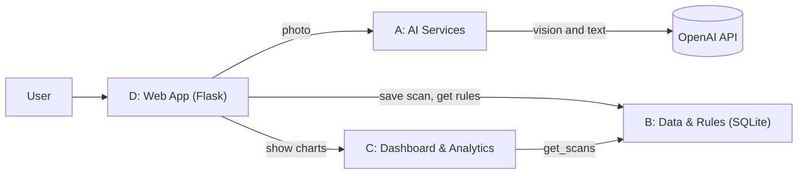
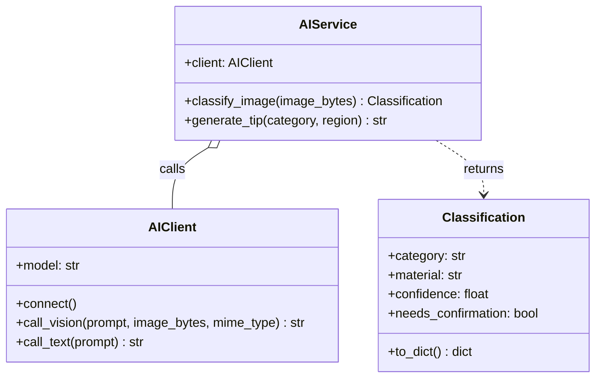
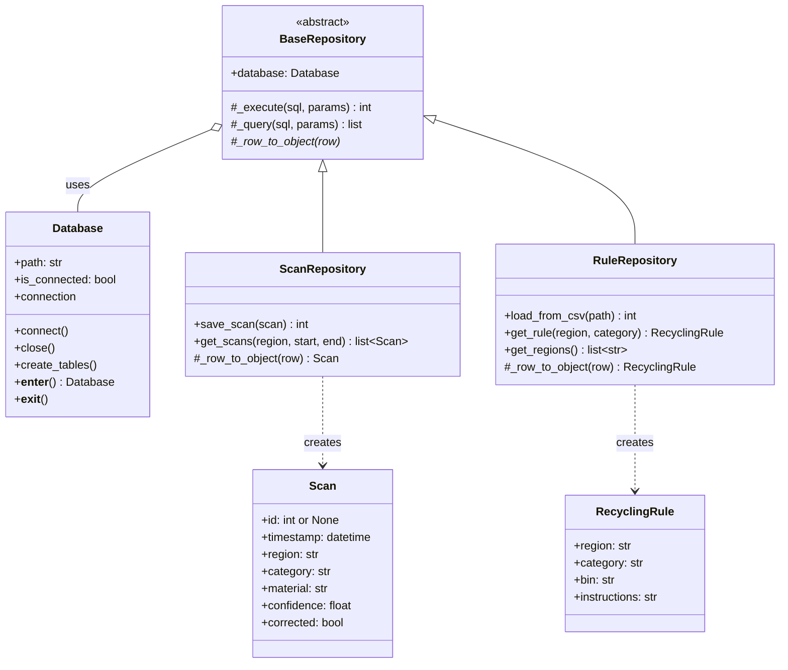
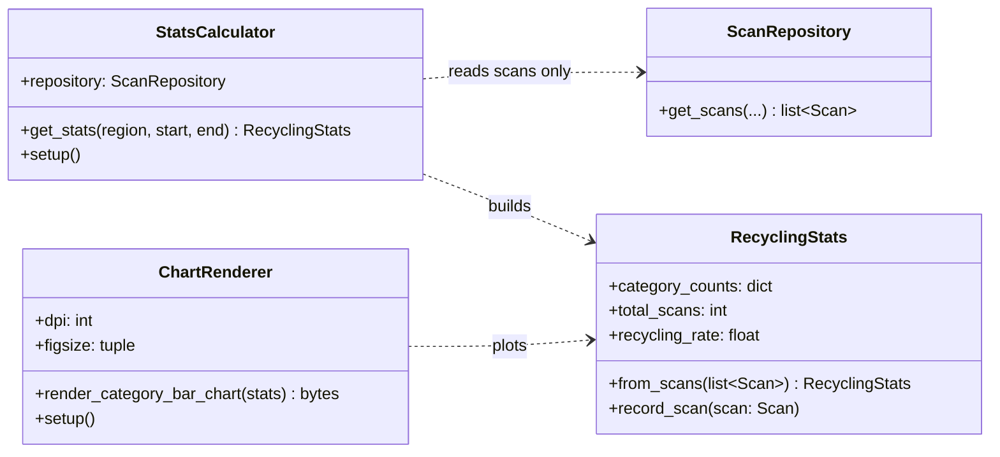
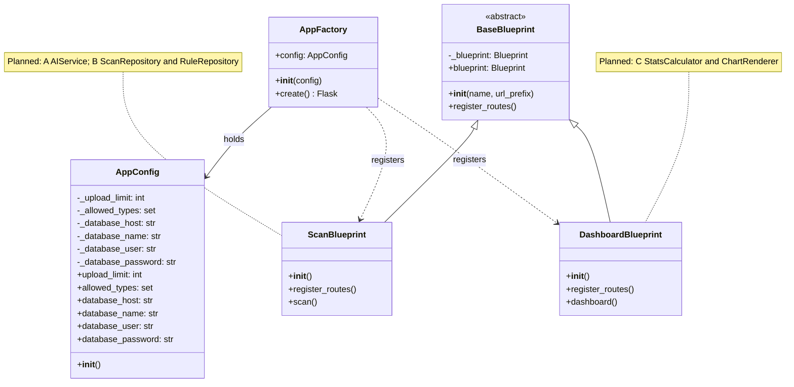

# AI-Powered Waste Sorting & Recycling Assistant

Photo-based household waste classification with region-specific disposal rules and recycling-rate analytics.

Capstone project, Compact Programming Course (Python), FH Dortmund, WS 2026/27.

**Problem:** people don't know which bin an item belongs in, and municipalities don't know their recycling rates.

## Team

| Member | Subsystem | Files |
|---|---|---|
| Oluwatimilehin Ogunme | A · AI Services | `ai_services.py`, `ai_prompts.py` |
| Terkuma Caleb Lumun | B · Data & Rules | `db.py`, `schema.sql`, `data/rules_seed.csv`, `tests/test_db.py` |
| Onyedikachi Onah | C · Dashboard & Analytics | `analytics.py` |
| Moye Nyuysoni Glein Perry | D · Web App & Integration | `app.py`, `templates/`, `Dockerfile` |

## Architecture



## Project structure

```
app/                  Flask app
  __init__.py         create_app()
  templates/          Jinja templates (D)
  ai_services.py      A · AI Services
  db.py, schema.sql   B · Data & Rules
  analytics.py        C · Dashboard & Analytics (RecyclingStats, StatsCalculator, ChartRenderer)
data/rules_seed.csv   B · recycling rules
tests/                pytest tests, one file per subsystem
requirements.txt      Python packages
```

## Getting started

Requires Python 3.12 or newer.

```bash
python -m venv .venv
.venv\Scripts\activate          # macOS/Linux: source .venv/bin/activate
pip install -r requirements.txt
flask --app app run             # http://127.0.0.1:5000
pytest                          # run the tests
```

## Branches

Each homework assignment has its own branch: `Homeworkassignment001`, `Homeworkassignment002`, …

## UML class diagrams

The diagrams follow the team presentation order A, B, C, then D.
Only classes implemented on this assignment branch are shown.

### Subsystem A (AI Services)



### Subsystem B (Data & Rules)



### Subsystem C (Dashboard & Analytics)



### Subsystem D (Web App & Integration)

Subsystem D's five implemented classes are shown below. Solid hollow-triangle
arrows show inheritance; the solid arrow from `AppFactory` to `AppConfig` shows
a stored-object association; dashed arrows show registration dependencies.
Notes beside the blueprints identify **planned**, not implemented, connections
to A, B and C. In HT1, the web routes only display styled preview pages;
live AI/database integration starts in HT3.



`create_app()` calls `AppFactory.create()`, which registers the two route
groups. Configuration lives in an `AppConfig` object; the web layer does not
yet store scan data. The dashed arrows represent registration dependencies,
not inheritance or implemented cross-subsystem calls.

**Where D's state lives:** `AppConfig` owns private configuration attributes;
`AppFactory.config` holds that configuration object; `BaseBlueprint._blueprint`
holds the Flask route group inherited by each concrete subclass. Properties
provide controlled access. Flask calls `scan()` or `dashboard()` after matching
the request URL. The shared templates and local CSS/JavaScript provide the
green-and-white interface; preview actions are explicitly disabled on HT1.

**Subsystem D — Web Application & Integration.** D provides the Flask user
interface and application structure for the Waste Sorting Assistant:

- `AppFactory` initializes Flask and registers the web routes.
- `ScanBlueprint` provides the scanning preview. It is **designed** to use A's
  `AIService` for classification and B's `ScanRepository` and `RuleRepository`
  for saving scans and retrieving regional disposal rules.
- `DashboardBlueprint` provides the dashboard preview. It is **designed** to
  display statistics from C's `StatsCalculator` and `ChartRenderer`.

For Homework Assignment 1, D demonstrates encapsulation, inheritance,
abstraction and initialization. These A/B/C connections are **planned
architecture only**: no scan or dashboard route calls those subsystems yet,
so the diagram intentionally has no dependency arrows to their classes.
`AppConfig` still shows its actual server-oriented settings; a future switch
to SQLite's `database_path` must change the Python class and UML together.

## Team video

[Watch the Hometask 1 team video](https://github.com/Timmyy3000/waste-sorting-assistant/releases/download/hometask-videos/Hometask1.mp4)
