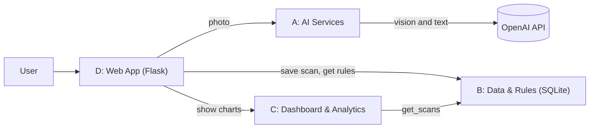

# AI-Powered Waste Sorting & Recycling Assistant

Photo-based household waste classification with region-specific disposal rules and recycling-rate analytics.

Capstone project, Compact Programming Course (Python), FH Dortmund, WS 2026/27.

**Problem:** people don't know which bin an item belongs in, and municipalities don't know their recycling rates.

## Team

| Member | Subsystem | Files |
|---|---|---|
| Oluwatimilehin Ogunme | A · AI Services | `ai_services.py` |
| Terkuma Caleb Lumun | B · Data & Rules | `db.py`, `schema.sql`, `data/rules_seed.csv` |
| Onyedikachi Onah | C · Dashboard & Analytics | `analytics.py` |
| Moye Nyuysoni Glein Perry | D · Web App & Integration | `app.py`, `templates/`, `Dockerfile` |

## Architecture

## Branches

Each homework assignment has its own branch: `Homeworkassignment001`, `Homeworkassignment002`, …

## UML class diagrams

_Added per subsystem as it is implemented._

## Team video

_Link added with each homework assignment._

---

_Generated with the assistance of AI._
