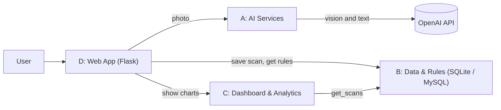
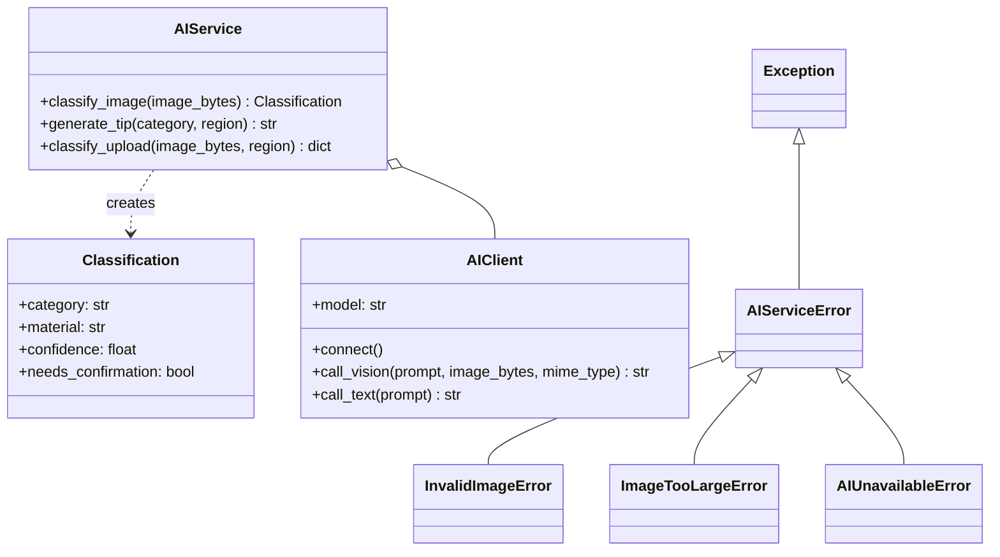
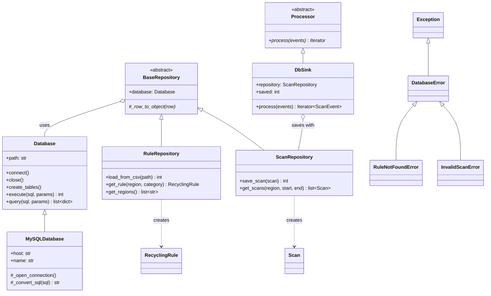
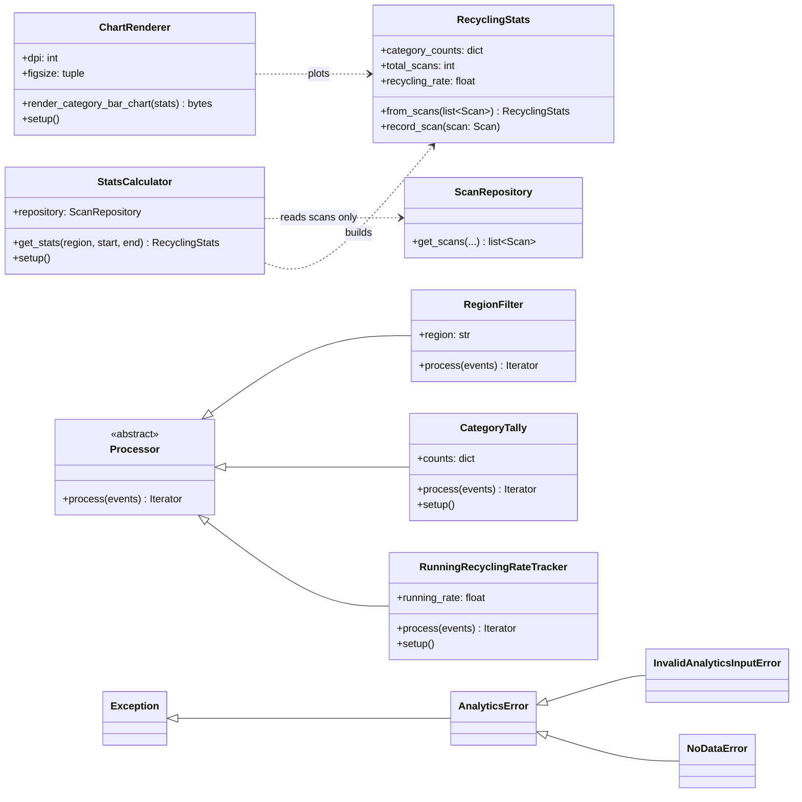
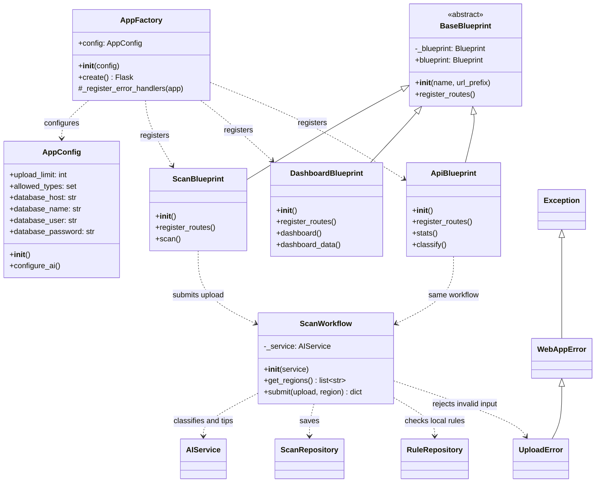
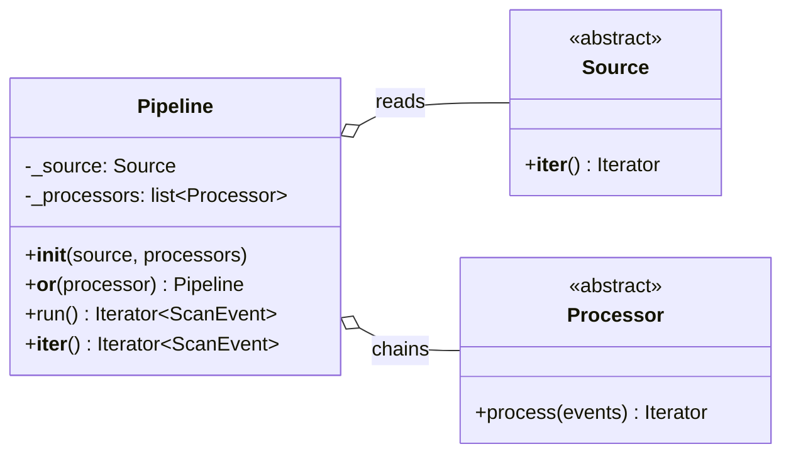

# AI-Powered Waste Sorting & Recycling Assistant

Photo-based household waste classification with region-specific disposal rules and recycling-rate analytics.

Capstone project, Compact Programming Course (Python), FH Dortmund, WS 2026/27.

**Problem:** people don't know which bin an item belongs in, and municipalities don't know their recycling rates.

## Team

| Member | Subsystem | Files |
|---|---|---|
| Oluwatimilehin Ogunme | A - AI Services | `ai_services.py`, `ai_prompts.py`, `pipeline.py`, `tests/test_ai_services.py` |
| Terkuma Caleb Lumun | B - Data & Rules | `db.py`, `schema.sql`, `schema_mysql.sql`, `data/rules_seed.csv`, `tests/test_db.py` |
| Onyedikachi Onah | C - Dashboard & Analytics | `analytics.py`, `tests/test_analytics.py` |
| Moye Nyuysoni Glein Perry | D - Web App & Integration | `app/__init__.py`, `app/routes/`, `app/templates/`, `Dockerfile`, `README.md` |

## Architecture



## Project structure

```
app/                  Flask app
  __init__.py         create_app()
  templates/          Jinja templates (D)
  ai_services.py      A - AI Services
  db.py, schema*.sql  B - Data & Rules
  analytics.py        C - Dashboard & Analytics (RecyclingStats, StatsCalculator, ChartRenderer)
data/rules_seed.csv   B - recycling rules
tests/                pytest tests, one file per subsystem
requirements.txt      Python packages
```

## Getting started

Requires Python 3.12 or newer.

```bash
python -m venv .venv
.venv\Scripts\activate          # macOS/Linux: source .venv/bin/activate
pip install -r requirements.txt
flask --app app run             # http://127.0.0.1:5000
pytest                          # run the tests
```

### AI configuration: one server, many browser users

The API key belongs to the **Flask server**, never to browser JavaScript.
People using the hosted site do not need a key. Someone running their own
server needs their own credential or administrator-provided secret.

1. Keep the key in a private file **outside this repository**, readable only by
   the server account. The key is never committed to Git.
2. Copy `.env.example` to `.env` and set `OPENAI_API_KEY_FILE` to that file's
   absolute path. Configure `OPENAI_BASE_URL` and `OPENAI_MODEL` if needed (see `.env.example`).
3. Start Flask normally. `AppConfig.configure_ai()` loads the secret server-side.
   An existing `OPENAI_API_KEY` environment variable takes precedence.

The app uses the **OpenAI API** by default (model `gpt-6-luna`, set with `OPENAI_MODEL`).
Because subsystem A uses the official OpenAI SDK, `OPENAI_BASE_URL` can optionally point it
at another OpenAI-compatible provider such as KI:connect (`https://chat.kiconnect.nrw/api/v1`).
Uploaded photos go to the provider for classification; only classification records,
not photo files, are stored here.

### Docker with MySQL

With the same local `.env` and external key file, run:

```bash
docker compose up --build
```

Open <http://localhost:5000/scan> or <http://localhost:5000/dashboard>.

Compose mounts the key as `/run/secrets/ai_api_key`; it is not baked into the
image. `.dockerignore` excludes local configuration, databases and credential
files. A Docker Compose file secret is a read-only file mount, not an encrypted
vault: the host administrator still controls it. Never commit the key or `.env`.

The supplied Flask command is a **local development server**, not a public
deployment. To share the app publicly, deploy the backend behind HTTPS with a
production WSGI server, authentication/usage limits appropriate to your provider
quota, and managed secrets. No public hosting has been provisioned by this repo.

## Branches

Each homework assignment has its own branch: `Homeassignment1`, `HomeworkAssignment2`, `HomeworkAssignment3`,
`HomeworkAssignment4`.
`main` is the final integrated application. The homework branches preserve their
assignment-specific versions; contributor branches are removed only after their
commits are verified as included in the matching homework branch.

## UML class diagrams

The diagrams follow the team presentation order A, B, C, then D.
Only classes implemented on this assignment branch are shown.

### Subsystem A (AI Services)



### Subsystem B (Data & Rules)



### Subsystem C (Dashboard & Analytics)



HT3: ``DashboardBlueprint`` (subsystem D's routes file) calls ``build_dashboard_payload()`` from ``analytics.py``, which uses only ``ScanRepository.get_scans()`` and returns JSON-friendly fields plus a base64 PNG. Endpoints: ``GET /dashboard`` (HTML + chart) and ``GET /dashboard/data`` (JSON).

### Subsystem D (Web App & Integration)

Moye's classes are shown last, matching the presentation order. Solid triangle
arrows mean inheritance; dashed arrows mean dependencies.



#### D's pipeline runner



**D data flow:** `create_app()` calls `AppFactory.create()` to configure the app,
load rules, register blueprints and install error handlers. Flask calls `scan()`
for an upload; `ScanWorkflow.submit()` validates it, calls A, reads B's rule, and
saves through B's repository. HTML and JSON routes share this workflow.
`dashboard_payload()` calls C's `build_dashboard_payload()` and adapts its counts
to exclude unknown items from the recycling-rate denominator. Connections are
opened and closed per request. Source and Processor belong to Timi; Pipeline
belongs to Moye. Run `python demo_pipeline.py` for the complete simulated chain.

Shared Jinja templates, local CSS and small JavaScript enhancements provide the
interface. Credentials are read by the server, never by the browser. HT1/HT2
contain styled previews; live integration starts in HT3.

## Testing and coverage

Run `pytest` for the team tests. The original 15-test target is retained and
expanded with regression cases for the new web workflow: real SQLite saves,
mocked classification, invalid regions/files, provider failures, rate handling,
JSON errors, date filters and static assets. Live-provider smoke checks are run
separately and do not make automated tests depend on the network or a real key.
Run `pytest --cov=app --cov-branch` for statement and branch coverage. Coverage
shows exercised code, not proof that every behaviour is correct.

Latest local verification on HT4: **35 tests passed**, with **78% combined
statement/branch coverage** using the command above. The KI:connect live smoke
test also passed on an isolated SQLite database with a synthetic bottle image;
it did not add artificial scans to the normal application database.

## Team video

[Watch the Hometask 4 team video](https://github.com/Timmyy3000/waste-sorting-assistant/releases/download/hometask-videos/Hometask4.mp4)
