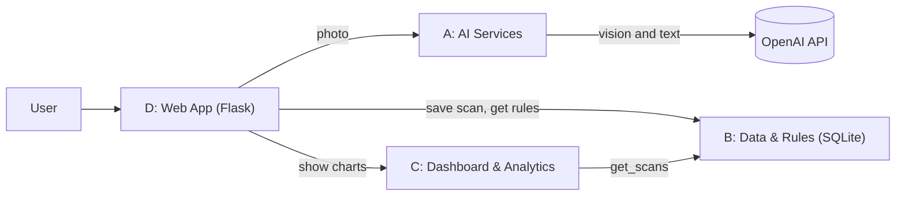

# AI-Powered Waste Sorting & Recycling Assistant

Photo-based household waste classification with region-specific disposal rules and recycling-rate analytics.

Capstone project, Compact Programming Course (Python), FH Dortmund, WS 2026/27.

**Problem:** people don't know which bin an item belongs in, and municipalities don't know their recycling rates.

## Team

| Member | Subsystem | Files |
|---|---|---|
| Oluwatimilehin Ogunme | A · AI Services | `ai_services.py` |
| Terkuma Caleb Lumun | B · Data & Rules | `db.py`, `schema.sql`, `data/rules_seed.csv` |
| Onyedikachi Onah | C · Dashboard & Analytics | `analytics.py` |
| Moye Nyuysoni Glein Perry | D · Web App & Integration | `app.py`, `templates/`, `Dockerfile` |

## Architecture



## Project structure

```
app/                  Flask app
  __init__.py         create_app()
  templates/          Jinja templates (D)
  ai_services.py      A · AI Services          (to be added)
  db.py, schema.sql   B · Data & Rules         (to be added)
  analytics.py        C · Dashboard & Analytics (to be added)
data/rules_seed.csv   B · recycling rules      (to be added)
tests/                pytest tests, one file per subsystem
requirements.txt      Python packages
```

## Getting started

Requires Python 3.12 or newer.

```bash
python -m venv .venv
.venv\Scripts\activate          # macOS/Linux: source .venv/bin/activate
pip install -r requirements.txt
flask --app app run             # http://127.0.0.1:5000
pytest                          # run the tests
```

## Branches

Each homework assignment has its own branch: `Homeworkassignment001`, `Homeworkassignment002`, …

## UML class diagrams

_Added per subsystem as it is implemented._

## Team video

_Link added with each homework assignment._
