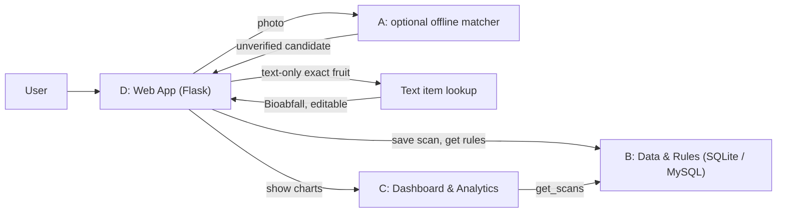
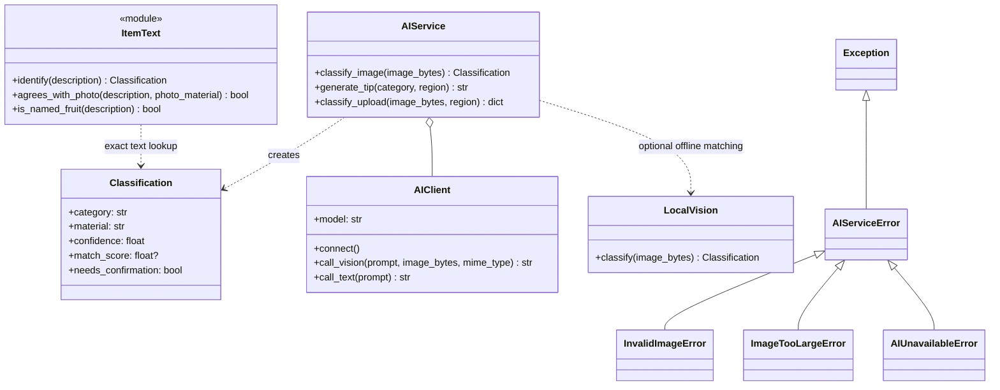
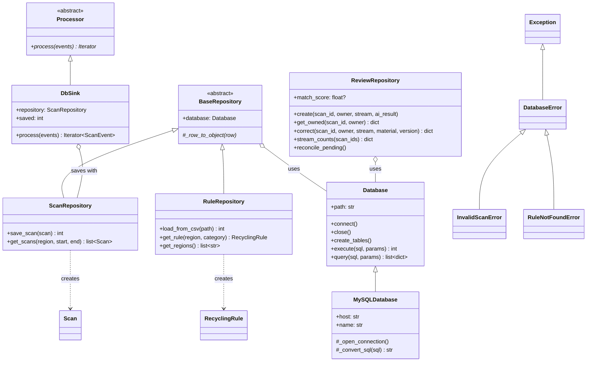
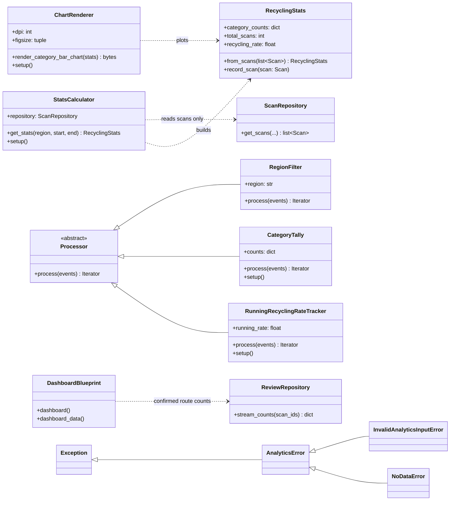
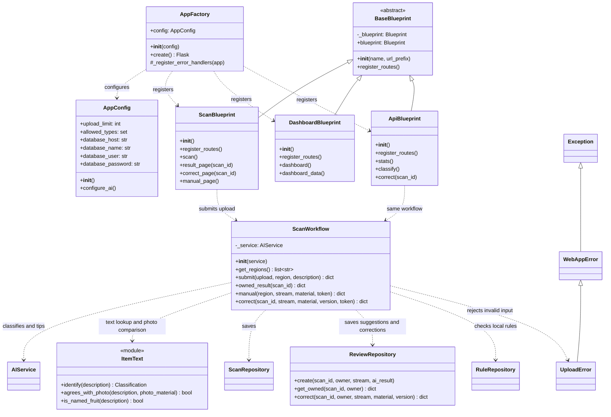
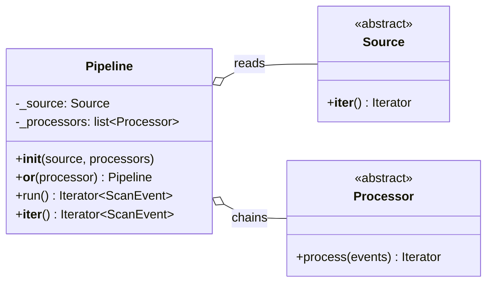
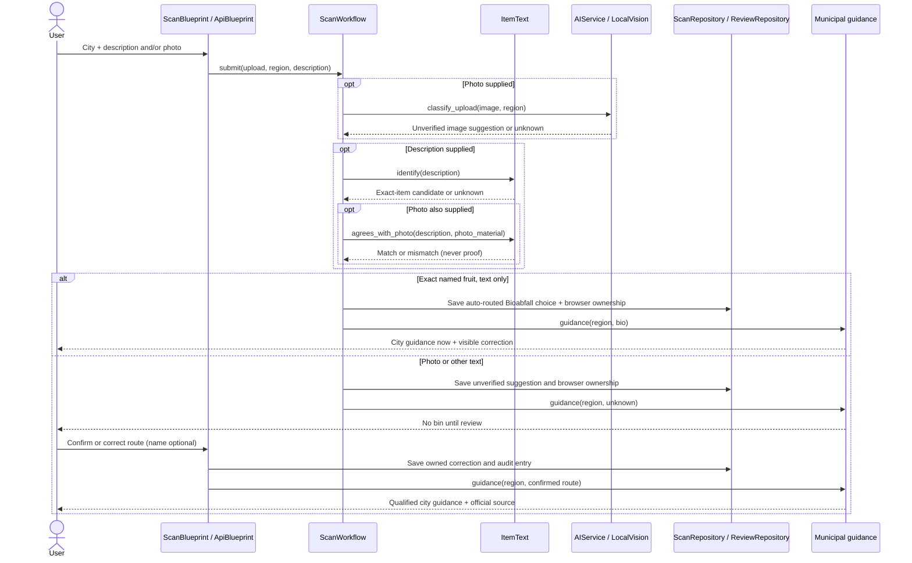

# AI-Powered Waste Sorting & Recycling Assistant

Capstone project of the Compact Programming Course with Python (CPC),
Fachhochschule Dortmund, WS 2026/27.

**Problem:** people often do not know which bin an item belongs in, and
municipalities do not know their recycling rates.

**What the app does:**
- A resident uploads a photo or types an item name and picks their city.
- The app classifies the item (recyclable, compostable, landfill) and shows the
  correct bin from that city's local recycling rules.
- The OpenAI API writes a short educational disposal tip for the item.
- Every scan is stored in a database. A dashboard for municipalities shows waste
  composition and recycling rates per region and date range.
- Photo recognition only suggests an item. The user confirms or corrects it
  before a bin is assigned, so a wrong AI guess never decides the bin.

## Screencast

Product demo of the running application (6 minutes): **[Watch the screencast on Google Drive](https://drive.google.com/file/d/1nI-dJue1pg_Cnj-VB1QrQ9kbbHIqIzoi/view?usp=drive_link)**

## Presentation

Final presentation slides: [PDF](docs/presentation/EcoSort_final_presentation.pdf) · [PowerPoint](docs/presentation/EcoSort_final_presentation.pptx)

## Sample images

`sample_images/` holds photos for trying the photo upload (banana peel, can, pizza box, coffee cup, battery, glass jar, plastic bottle). Sources and licences: [sample_images/CREDITS.md](sample_images/CREDITS.md).

## Team

| Member | Subsystem | Files |
|---|---|---|
| Oluwatimilehin Ogunme | A - AI Services | `ai_services.py`, `ai_prompts.py`, `pipeline.py`, `tests/test_ai_services.py` |
| Terkuma Caleb Lumun | B - Data & Rules | `db.py`, `schema.sql`, `schema_mysql.sql`, `data/rules_seed.csv`, `tests/test_db.py` |
| Onyedikachi Onah | C - Dashboard & Analytics | `analytics.py`, `tests/test_analytics.py` |
| Moye Nyuysoni Glein Perry | D - Web App & Integration | `app/__init__.py`, `app/routes/`, `app/templates/`, `Dockerfile`, `README.md` |

## Architecture



## Project structure

```
app/                  Flask app
  __init__.py         create_app()
  templates/          Jinja templates (D)
  ai_services.py      A - AI Services
  db.py, schema*.sql  B - Data & Rules
  analytics.py        C - Dashboard & Analytics (RecyclingStats, StatsCalculator, ChartRenderer)
data/rules_seed.csv   B - recycling rules
tests/                pytest tests, one file per subsystem
requirements.txt      Python packages
```

## Getting started

Requires Python 3.12 or newer.

```bash
python -m venv .venv
.venv\Scripts\activate          # macOS/Linux: source .venv/bin/activate
pip install -r requirements.txt
flask --app app run             # http://127.0.0.1:5000
pytest                          # run the tests
```

### AI configuration: one server, many browser users

The API key belongs to the **Flask server**, never to browser JavaScript.
People using the hosted site do not need a key. Someone running their own
server needs their own credential or administrator-provided secret.

1. Keep the key in a private file **outside this repository**, readable only by
   the server account. The key is never committed to Git.
2. Copy `.env.example` to `.env` and set `OPENAI_API_KEY_FILE` to that file's
   absolute path. Configure `OPENAI_BASE_URL` and `OPENAI_MODEL` if needed (see `.env.example`).
3. Start Flask normally. `AppConfig.configure_ai()` loads the secret server-side.
   An existing `OPENAI_API_KEY` environment variable takes precedence.

**Replace the key:** the repository contains no API key. Put your own key in the
key file (or the `OPENAI_API_KEY` variable) before starting the app. The
placeholders to replace are listed in `.env.example`. Any OpenAI-compatible
provider works by changing three values in `.env`:

| Provider | `OPENAI_BASE_URL` | `OPENAI_MODEL` | Key |
|---|---|---|---|
| OpenAI (default) | leave unset | `gpt-6-luna` | your OpenAI API key |
| KI:connect NRW (FH login) | `https://chat.kiconnect.nrw/api/v1` | a model listed in KI:connect | your KI:connect API key |
| Google Gemini | `https://generativelanguage.googleapis.com/v1beta/openai/` | a Gemini model from Google AI Studio | your Gemini API key |

With KI:connect, the app switches photo recognition off (see below) and uses
text descriptions and AI tips only.

The app uses the **OpenAI API** by default (model `gpt-6-luna`). `OPENAI_BASE_URL` can
optionally point it at an OpenAI-compatible provider such as KI:connect
(`https://chat.kiconnect.nrw/api/v1`); we tested that provider as follows.
**Photo classification is not verified on this provider.** Live checks with
`mistralai-mistral-small-4` mislabeled cardboard, metal, glass and plastic with
high reported confidence; sending an image successfully did not mean the model
actually interpreted it. For this endpoint the app deliberately does not call
the model: uploads receive an `unknown` result and a prompt to consult local
guidance, not a guessed bin. A separately configured, verified vision provider
can use the normal classification workflow. Even then, model confidence is not
measured accuracy and local rules are category-level, not item-specific. Only
classification records, not photo files, are stored here.

### German disposal guidance and corrections

Results use conservative disposal routes: **Bioabfall, Restmüll, paper/cardboard,
lightweight packaging, Altglas, Pfand returns, electronics/batteries, hazardous
waste, bulky waste and end-of-life vehicles**. A bottle cannot be assigned a bin
from material alone: check for Pfand first. Food scraps generally belong in the
Biotonne, but local rules for meat/cooked food vary. Munich's packaging collection
is changing in 2026–27, so users must verify their address against AWM. Each
result links to the official EDG, BSR or AWM waste guide. The app is not a
complete Abfall-ABC and cannot guarantee correct disposal for every item.

Use **Sort without a photo** when no reliable vision service is available. You
choose the item and disposal route, then the server shows the local guidance.
Or use the main form with **text only** (for example, "apple" or "banana peel"),
**photo only**, or **photo plus text**. Text uses a short exact-item vocabulary:
exact text-only names of common fruit (including "apple", "banana", "orange"
and "fruit") automatically show the city's **Bioabfall** guidance when they
refer to discarded produce. This is based on what the user typed, **not** an
AI check. Edible fruit need not be discarded, and the route remains editable.
Unrecognised or compound names such as "apple juice carton", bottles and
hazardous items are **not** automatically routed.
If photo and text disagree, or the photo provider
cannot verify the claim, the result remains unresolved. Agreement does not
prove identity. For any unconfirmed suggestion, no bin is displayed; identify
the item and choose the route to reveal local guidance. Text-only and combined
inputs share the same HTML/API route, database and correction history.
The local matcher shows its **raw cosine similarity** (e.g. 0.335) before the
city; this is not a percentage, probability or confidence. A different vision
provider's reported percentage is shown only if supplied. Text-only lookups
have no model score and do not show a misleading empty score row. Existing
older scans without stored similarity remain accessible but cannot gain a
historical score without rescanning. A nullable score column is added without
discarding existing SQLite or MySQL review records.
Even a provider-reported 90%+ is not verified accuracy (KI:connect previously
reported high scores for wrong objects), so it never automatically commits a bin.
The confirmation form has a visible route selector and button; the item name
is optional and defaults to the suggested name when left empty. Confirmed routes
show an original illustration. An unresolved bottle can show an illustrative
Pfand return machine solely as a reminder to check the deposit mark, **not** as
a Pfand determination.
After a scan, use **Correct or confirm this result** to identify the item and
choose the appropriate route. The database preserves the initial model response
and an append-only correction log, while the dashboard and JSON statistics use
the latest saved choice. Recent history is visible only to the browser that
created it. Older scans remain in aggregate statistics but are not editable.
Confirming in the HTML form returns to the dashboard with a saved-choice message;
the recent-scans table links back to the editable result. Confirmed or corrected
photos are indexed by SHA-256 of their normalised bytes, city and anonymous
browser owner. Uploading the exact same photo again in that city/browser reuses
the saved choice (labelled **Previously confirmed by you**) instead of calling
the model or adding a duplicate scan to dashboard counts. A different photo,
city or browser still requires review. Photos themselves are never stored, so
older scans without a fingerprint cannot be matched retroactively. The original
visual similarity remains unchanged after confirmation: saving a choice does
not retrain the image model or prove that all photos of the same fruit match.
Even a high-confidence model suggestion does **not** display a bin until the
user confirms or corrects it. This prevents a model confusing a whole banana
with a banana peel from immediately giving disposal instructions.
Cookies and a CSRF token protect corrections, but anonymous browser ownership
is not an account system: clearing cookies loses access to previous edits. Set
`FLASK_SECRET_KEY` to a persistent, unpredictable server secret for deployment
or access to browser-owned scans will be lost after a restart. Do not share a
single browser session among multiple people. Public deployment additionally
requires authentication, HTTPS, rate limits and privacy review.

Dashboard figures are **counts of confirmed choices and exact-name auto-routed
fruit**, not measured real-world recycling or validated AI accuracy. User
corrections do not retrain the model.
KI:connect's photo output remains untrusted: live checks mislabeled glass as a
banana peel. The optional **offline vision matcher** below can supply candidate
items without sending photos to that provider.

Install [Xenova's quantized CLIP model](https://huggingface.co/Xenova/clip-vit-base-patch32)
(MIT-licensed, ~155 MB) outside Git with
`python scripts/install_local_vision.py --directory /absolute/path/to/model`.
Set `LOCAL_VISION_MODEL_DIR` to that path in the ignored `.env`, then restart the
server. The local model compares visual features with a limited vocabulary. It
can suggest broad categories for some photos, but is **not trained on the
TrashPanda dataset**, its similarity is **not a probability**, and ambiguous
whole bananas vs peels, bottle material or Pfand still require user review.
The result shows the suggested item/category but **withholds a disposal bin
until the user confirms or corrects** the result. Without installed weights,
KI:connect remains disabled and the app safely offers manual sorting instead.
A local smoke check on isolated SQLite suggested paper for cardboard and a broad
compostable category for a banana peel, but could not resolve some other items
reliably. This is **not an accuracy benchmark**. Similarity is never shown as a
percentage or treated as confidence. All unconfirmed results withhold bin advice.

### Image formats and model evaluation

The upload form accepts JPG, PNG, WebP, still GIF, BMP, TIFF, AVIF and HEIC/HEIF.
Pillow (and `pillow-heif` for HEIC) checks the **actual bytes**, rejects corrupt,
animated or excessively large images, corrects camera orientation, and prepares
a resized JPEG for the configured recogniser. The offline matcher keeps photos
on this server. SVG and other active formats are
not accepted. The 5 MB input limit and 20-megapixel pixel limit still apply.
The homepage illustrates each collection stream using original SVG drawings,
not photographs of local municipal containers; the city guide remains the
source of truth. A visible build label and `X-App-Version` header help detect an
old server process, and versioned asset URLs prevent stale browser CSS/JS.

[TrashPanda](https://huggingface.co/datasets/rfabrik/TrashPanda) describes six
German waste classes, but its dataset card does not declare a licence. Do not
copy, redistribute or train on its images until permission is verified. An
optional local-only evaluation script is provided for appropriately obtained
files: `python scripts/evaluate_trashpanda.py PATH_TO_TRASHPANDA`. It uses the
offline matcher when installed, refuses unverified KI:connect vision and reports repeated predictions without
modifying the application database. A matching broad class is not proof of
correct disposal (notably for Pfand bottles and mixed/special waste).

### Docker with MySQL

On Windows, Docker Desktop's official installer supports a custom
`--installation-dir=D:\DockerDesktop` and
`--wsl-default-data-root=D:\DockerData` (WSL 2). Install and verify those
locations **before** pulling the MySQL image; otherwise its image/volume may
consume C:. An existing WSL distribution, Windows system files and some user
configuration may still live on C:. The project does not require a separate
host MySQL installation: the `mysql:8.4` container supplies MySQL and stores
its data in Docker's volume on the configured Docker data disk. Keep the
existing `data/waste.db` if migrating from local SQLite; Docker's MySQL starts
with an independent database and does not import those records automatically.

With the same local `.env` and external key file, run:

```bash
docker compose up --build
```

Open <http://localhost:5000/scan> or <http://localhost:5000/dashboard>.

Compose mounts the key as `/run/secrets/ai_api_key`; it is not baked into the
image. `.dockerignore` excludes local configuration, databases and credential
files. A Docker Compose file secret is a read-only file mount, not an encrypted
vault: the host administrator still controls it. Never commit the key or `.env`.
MySQL's healthcheck performs an authenticated TCP query against the application
database, rather than accepting its socket-only initialization server. Web also
restarts on failure. For a non-destructive fresh-start check, use a separate
Compose project name and volume (e.g. `docker compose -p waste_fresh up --build`);
do not run `down -v` on a project with scans you want to retain. Compose does
not include offline model weights by default. To enable the installed offline
model, set the host's `LOCAL_VISION_MODEL_DIR` in the ignored `.env` and run
`docker compose -f docker-compose.yml -f docker-compose.vision.yml up --build`.
This mounts the host model read-only at `/opt/waste-vision` inside the web
container. It does not copy model weights into Git or the Docker image.

The supplied Flask command is a **local development server**, not a public
deployment. To share the app publicly, deploy the backend behind HTTPS with a
production WSGI server, authentication/usage limits appropriate to your provider
quota, and managed secrets. No public hosting has been provisioned by this repo.

## UML class diagrams

The diagrams follow the team presentation order A, B, C, then D.

### Subsystem A (AI Services)



### Subsystem B (Data & Rules)



### Subsystem C (Dashboard & Analytics)



HT3: ``DashboardBlueprint`` (subsystem D's routes file) calls ``build_dashboard_payload()`` from ``analytics.py``, which uses only ``ScanRepository.get_scans()`` and returns JSON-friendly fields plus a base64 PNG. Endpoints: ``GET /dashboard`` (HTML + chart) and ``GET /dashboard/data`` (JSON).

### Subsystem D (Web App & Integration)

Moye's classes are shown last, matching the presentation order. Solid triangle
arrows mean inheritance; dashed arrows mean dependencies.



#### D's pipeline runner



**D data flow:** `create_app()` calls `AppFactory.create()` to configure the app,
load rules, register blueprints and install error handlers. Flask calls `scan()`
for text and/or an upload; `ScanWorkflow.submit()` validates both, compares
optional photo and description, then saves an unverified suggestion through B's
repositories. HTML and JSON routes share this workflow. A user-owned correction
reveals reviewed local guidance; model output alone never reveals a bin.
`dashboard_payload()` calls C's `build_dashboard_payload()` and adapts its counts
to exclude unknown items from the recycling-rate denominator. Connections are
opened and closed per request. Source and Processor belong to Timi; Pipeline
belongs to Moye. Run `python demo_pipeline.py` for the complete simulated chain.

### Text + photo sorting sequence



Shared Jinja templates, local CSS and small JavaScript enhancements provide the
interface. Credentials are read by the server, never by the browser. HT1/HT2
contain styled previews; live integration starts in HT3.

## Testing and coverage

```bash
pytest                              # run all unit tests
pytest --cov=app --cov-branch       # with statement and branch coverage
```

**Current result (main, Python 3.12): 89 passed, 80 % total coverage.**

| Subsystem | Test file(s) | Main module coverage |
|---|---|---|
| A - AI Services | `test_ai_services.py` | `ai_services.py` 74 %, `pipeline.py` 100 %, `ai_prompts.py` 100 % |
| B - Data & Rules | `test_db.py` | `db.py` 80 % |
| C - Dashboard & Analytics | `test_analytics.py` | `analytics.py` 70 % |
| D - Web App & Integration | `test_app.py`, `test_image_uploads.py` | `routes/scan.py` 93 %, `routes/dashboard.py` 98 %, `__init__.py` 95 % |

The tests mock the AI provider, so they need no network or API key. They use a
temporary SQLite database, so they do not change the normal dashboard data.
Coverage shows which code ran in the tests. It does not prove that photo
recognition is accurate.
