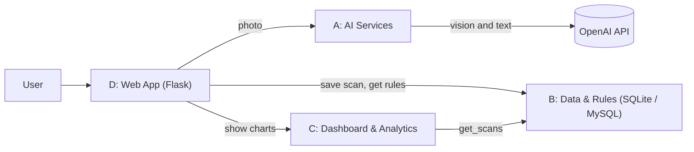
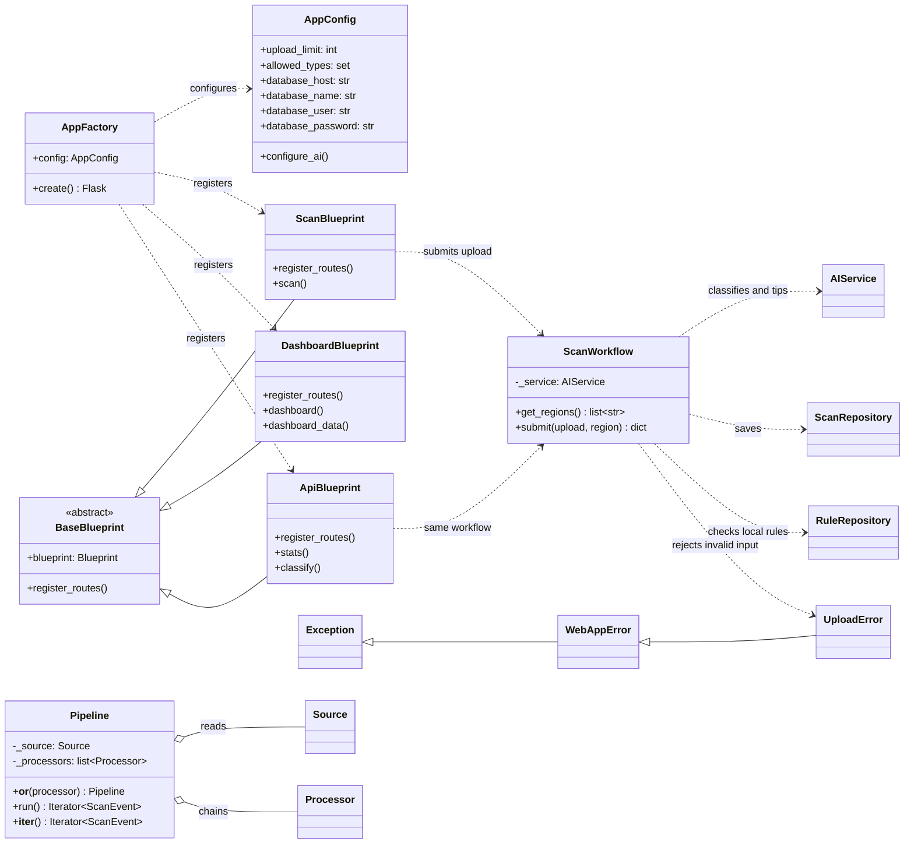
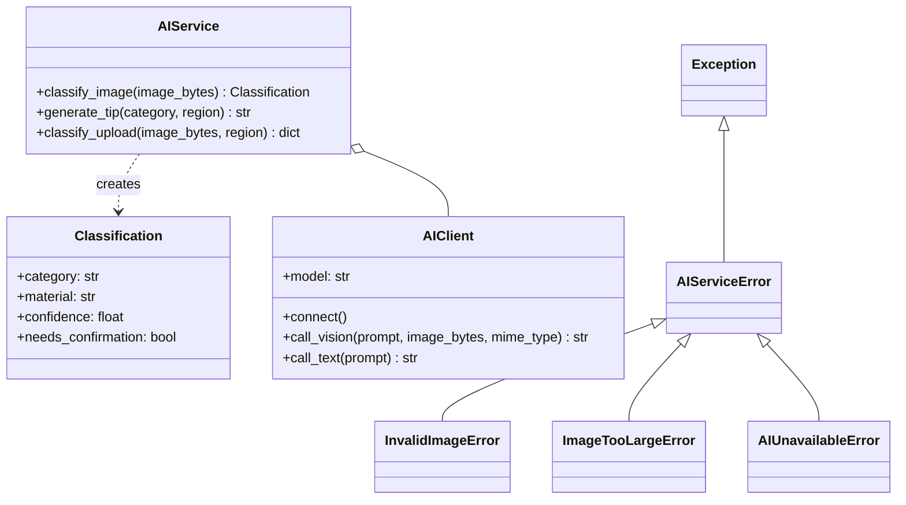
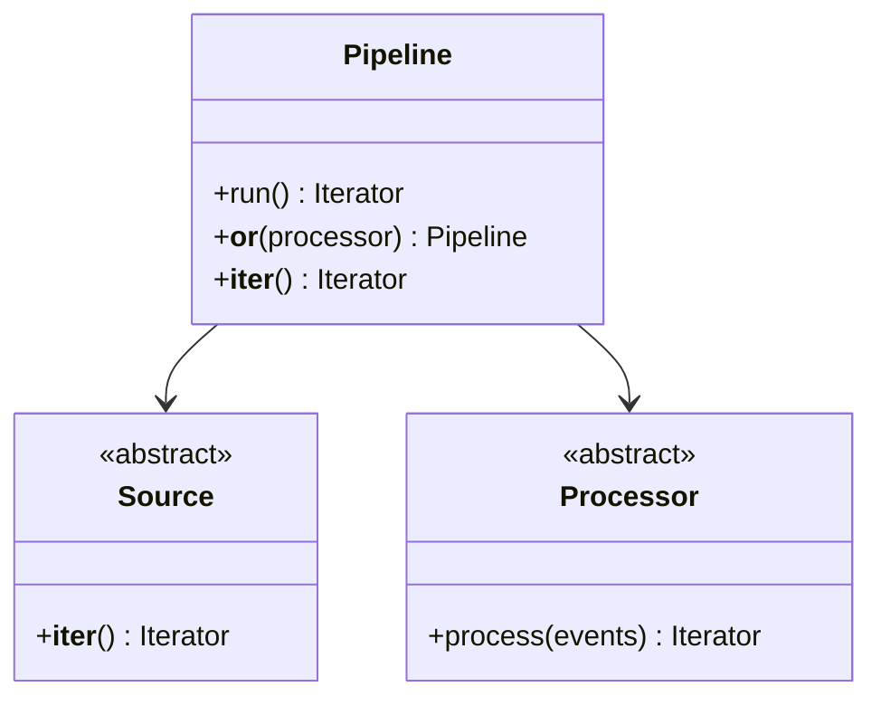
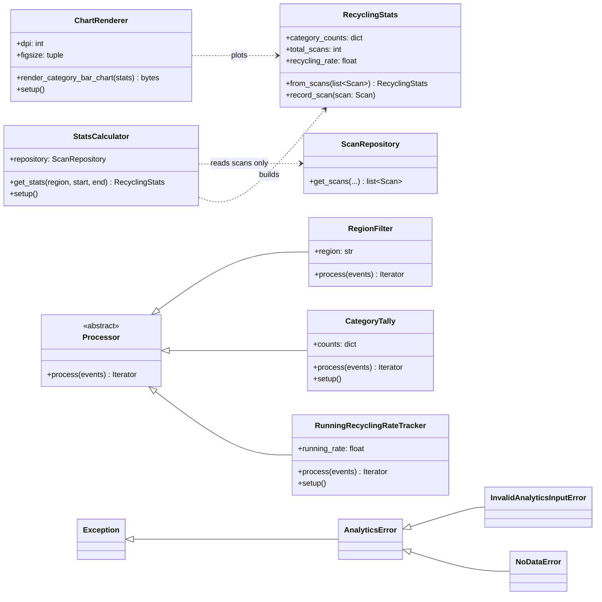

# AI-Powered Waste Sorting & Recycling Assistant

Photo-based household waste classification with region-specific disposal rules and recycling-rate analytics.

Capstone project, Compact Programming Course (Python), FH Dortmund, WS 2026/27.

**Problem:** people don't know which bin an item belongs in, and municipalities don't know their recycling rates.

## Team

| Member | Subsystem | Files |
|---|---|---|
| Oluwatimilehin Ogunme | A ┬À AI Services | `ai_services.py` |
| Terkuma Caleb Lumun | B ┬À Data & Rules | `db.py`, `schema.sql`, `schema_mysql.sql`, `data/rules_seed.csv`, `tests/test_db.py` |
| Onyedikachi Onah | C ┬À Dashboard & Analytics | `analytics.py` |
| Moye Nyuysoni Glein Perry | D ┬À Web App & Integration | `app/__init__.py`, `app/routes/`, `app/templates/`, `Dockerfile`, `README.md` |

## Architecture



## Project structure

```
app/                  Flask app
  __init__.py         create_app()
  templates/          Jinja templates (D)
  ai_services.py      A ┬À AI Services
  db.py, schema*.sql  B ┬À Data & Rules
  analytics.py        C ┬À Dashboard & Analytics (RecyclingStats, StatsCalculator, ChartRenderer)
data/rules_seed.csv   B ┬À recycling rules
tests/                pytest tests, one file per subsystem
requirements.txt      Python packages
```

## Getting started

Requires Python 3.12 or newer.

```bash
python -m venv .venv
.venv\Scripts\activate          # macOS/Linux: source .venv/bin/activate
pip install -r requirements.txt
flask --app app run             # http://127.0.0.1:5000
pytest                          # run the tests
```

### AI configuration: one server, many browser users

The API key belongs to the **Flask server**, never to browser JavaScript.
People using the hosted site do not need a key. Someone running their own
server needs their own credential or administrator-provided secret.

1. Keep the key in a private file **outside this repository**, readable only by
   the server account. The provided Desktop key has been copied to a protected
   local application folder on the development machine; it is not in Git.
2. Copy `.env.example` to `.env` and set `OPENAI_API_KEY_FILE` to that file's
   absolute path. Configure `OPENAI_BASE_URL` and `OPENAI_MODEL` as in the example.
3. Start Flask normally. `AppConfig.configure_ai()` loads the secret server-side.
   An existing `OPENAI_API_KEY` environment variable takes precedence.

The configured provider is KI:connect at `https://chat.kiconnect.nrw/api/v1`.
`mistralai-mistral-small-4` was verified with an image-input request. The existing
subsystem A client uses the OpenAI SDK's `OPENAI_BASE_URL` environment support;
its implementation is unchanged. Uploaded photos go to this provider for
classification; only classification records, not photo files, are stored here.

### Docker with MySQL

With the same local `.env` and external key file, run:

```bash
docker compose up --build
```

Open <http://localhost:5000/scan> or <http://localhost:5000/dashboard>.

Compose mounts the key as `/run/secrets/ai_api_key`; it is not baked into the
image. `.dockerignore` excludes local configuration, databases and credential
files. A Docker Compose file secret is a read-only file mount, not an encrypted
vault: the host administrator still controls it. Never commit the key or `.env`.

The supplied Flask command is a **local development server**, not a public
deployment. To share the app publicly, deploy the backend behind HTTPS with a
production WSGI server, authentication/usage limits appropriate to your provider
quota, and managed secrets. No public hosting has been provisioned by this repo.

## Branches

Each homework assignment has its own branch: `Homeworkassignment001` through `Homeworkassignment004`.

## UML class diagrams

### Subsystem D (Web App & Integration)

Subsystem D's implemented classes. Solid triangle arrows show inheritance and
dashed arrows show dependencies.



**D data flow:** `create_app()` → `AppFactory.create()` → config, rule setup,
blueprint registration, error handlers. Flask calls `scan()` for an upload;
`ScanWorkflow.submit()` validates the file/region, calls A, reads B's rule,
and saves through B's repository. Both HTML and JSON routes use this workflow.
`DashboardBlueprint` and `ApiBlueprint` use `dashboard_payload()`, which calls
C's `build_dashboard_payload()`. The web adapter uses C's category counts to
exclude `unknown` scans from the agreed recycling-rate denominator.

The responsive Jinja templates share `base.html`, SVG icons, an upload partial,
local CSS, and small JavaScript enhancements. No CDN, frontend framework or
browser-side credential is required. Earlier homework branches keep their own
smaller D diagrams; HT1/HT2 pages explicitly identify preview-only features.

### Subsystem A (AI Services)



`create_app()` calls `AppFactory.create()`, which loads rules and registers the
three route groups. Each request opens and closes its own database connection.

HT2 stream runner:



Run `python demo_pipeline.py` for an integrated stream through subsystem C's
processors and subsystem B's database sink.

### Subsystem B (Data & Rules)


### Subsystem C (Dashboard & Analytics)



HT3: ``DashboardBlueprint`` (subsystem D's routes file) calls ``build_dashboard_payload()`` from ``analytics.py``, which uses only ``ScanRepository.get_scans()`` and returns JSON-friendly fields plus a base64 PNG. Endpoints: ``GET /dashboard`` (HTML + chart) and ``GET /dashboard/data`` (JSON).

## Testing and coverage

Run `pytest` for the team tests. The original 15-test target is retained and
expanded with regression cases for the new web workflow: real SQLite saves,
mocked classification, invalid regions/files, provider failures, rate handling,
JSON errors, date filters and static assets. Live-provider smoke checks are run
separately and do not make automated tests depend on the network or a real key.
Run `pytest --cov=app --cov-branch` for statement and branch coverage. Coverage
shows exercised code, not proof that every behaviour is correct.

## Team video

_Link added with each homework assignment._
