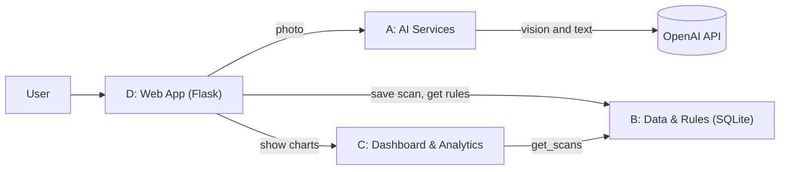
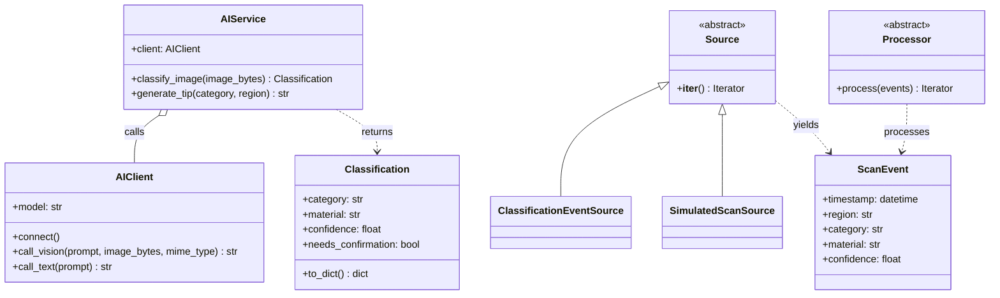
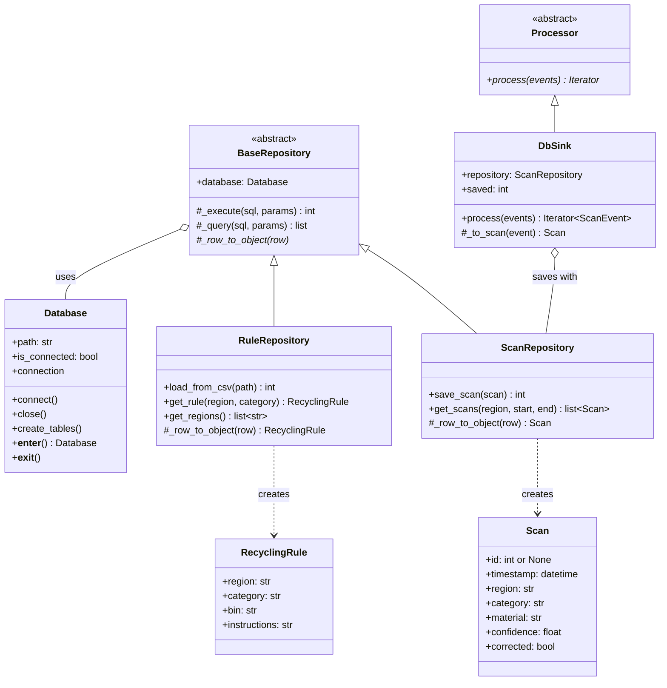
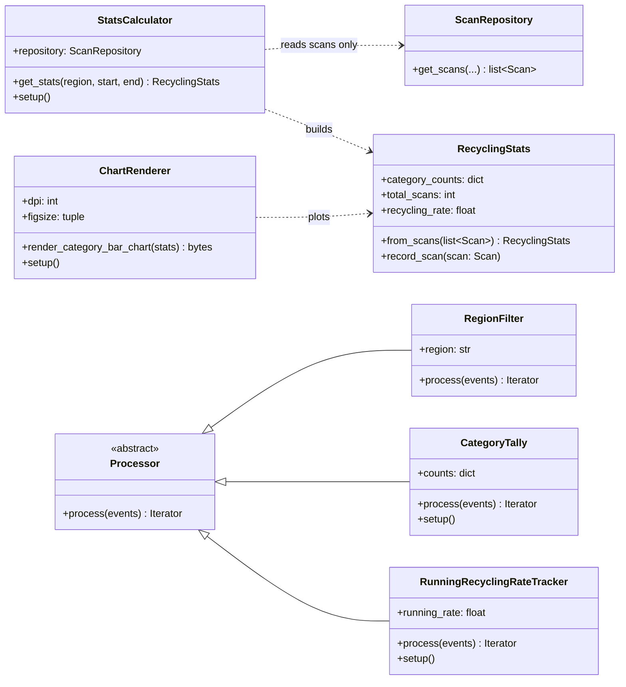
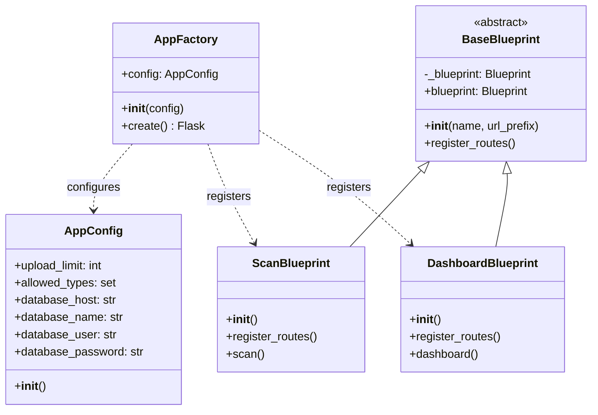
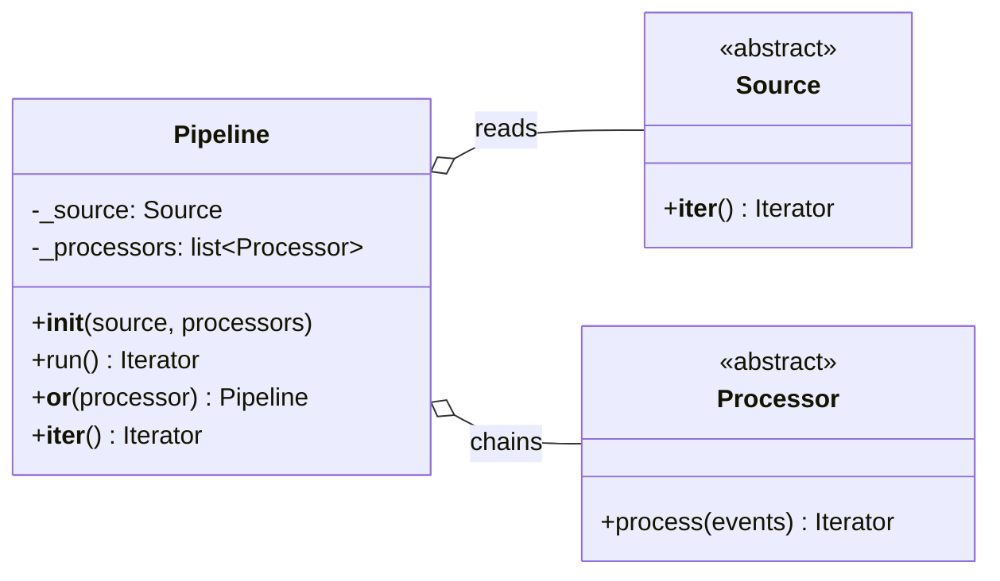

# AI-Powered Waste Sorting & Recycling Assistant

Photo-based household waste classification with region-specific disposal rules and recycling-rate analytics.

Capstone project, Compact Programming Course (Python), FH Dortmund, WS 2026/27.

**Problem:** people don't know which bin an item belongs in, and municipalities don't know their recycling rates.

## Team

| Member | Subsystem | Files |
|---|---|---|
| Oluwatimilehin Ogunme | A · AI Services | `ai_services.py` |
| Terkuma Caleb Lumun | B · Data & Rules | `db.py`, `schema.sql`, `data/rules_seed.csv`, `tests/test_db.py` |
| Onyedikachi Onah | C · Dashboard & Analytics | `analytics.py` |
| Moye Nyuysoni Glein Perry | D · Web App & Integration | `app.py`, `templates/`, `Dockerfile` |

## Architecture



## Project structure

```
app/                  Flask app
  __init__.py         create_app()
  templates/          Jinja templates (D)
  ai_services.py      A · AI Services
  db.py, schema.sql   B · Data & Rules
  analytics.py        C · Dashboard & Analytics (RecyclingStats, StatsCalculator, ChartRenderer)
data/rules_seed.csv   B · recycling rules
tests/                pytest tests, one file per subsystem
requirements.txt      Python packages
```

## Getting started

Requires Python 3.12 or newer.

```bash
python -m venv .venv
.venv\Scripts\activate          # macOS/Linux: source .venv/bin/activate
pip install -r requirements.txt
flask --app app run             # http://127.0.0.1:5000
pytest                          # run the tests
```

## Branches

Each homework assignment has its own branch: `Homeworkassignment001`, `Homeworkassignment002`, …

## UML class diagrams

The diagrams follow the team presentation order A, B, C, then D.
Only classes implemented on this assignment branch are shown.

### Subsystem A (AI Services)



### Subsystem B (Data & Rules)



### Subsystem C (Dashboard & Analytics)



### Subsystem D (Web App & Integration)

HT2 retains the HT1 blueprint hierarchy and adds Moye's Pipeline runner.
The web pages are styled previews; live integration starts in HT3.



#### D's HT2 pipeline runner



Run `python demo_pipeline.py` for the complete simulated stream through C's
filter/counters and B's database sink. `Pipeline.__or__()` returns a new chain;
`run()` connects the lazy generators; `__iter__()` enables for loops. Source and
Processor are Timi's contracts, not classes owned by D. Configuration lives in
AppConfig, route groups in BaseBlueprint, and the processor list in Pipeline.

## Team video

_Link added with each homework assignment._
