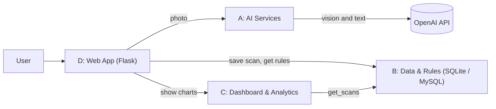
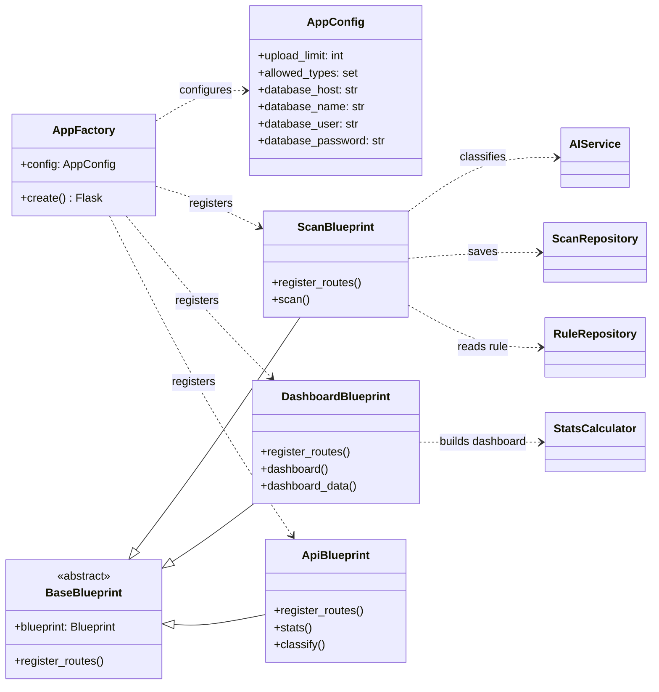
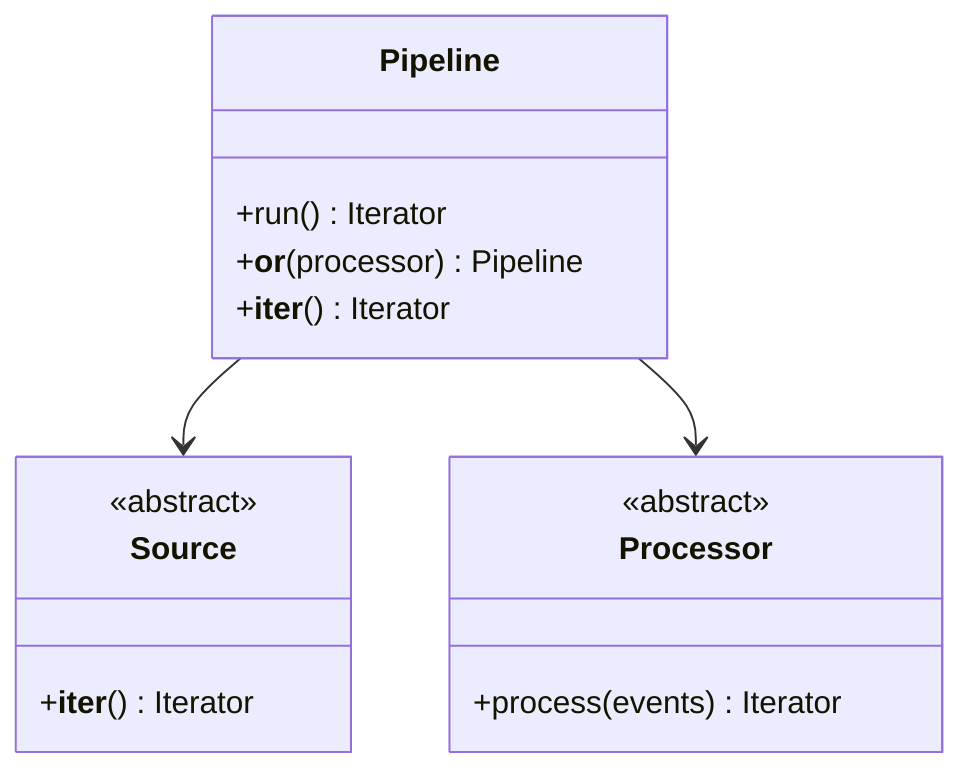
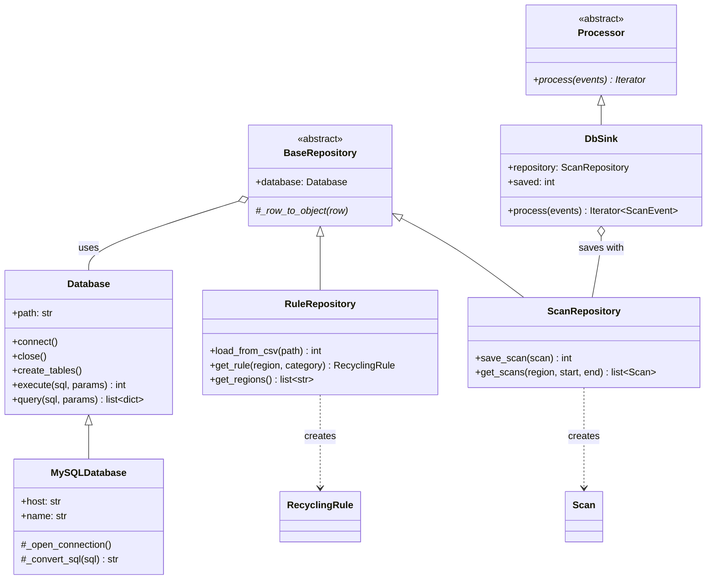
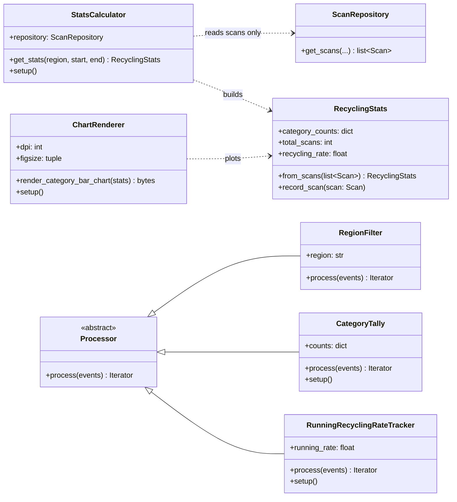

# AI-Powered Waste Sorting & Recycling Assistant

Photo-based household waste classification with region-specific disposal rules and recycling-rate analytics.

Capstone project, Compact Programming Course (Python), FH Dortmund, WS 2026/27.

**Problem:** people don't know which bin an item belongs in, and municipalities don't know their recycling rates.

## Team

| Member | Subsystem | Files |
|---|---|---|
| Oluwatimilehin Ogunme | A · AI Services | `ai_services.py` |
| Terkuma Caleb Lumun | B · Data & Rules | `db.py`, `schema.sql`, `schema_mysql.sql`, `data/rules_seed.csv`, `tests/test_db.py` |
| Onyedikachi Onah | C · Dashboard & Analytics | `analytics.py` |
| Moye Nyuysoni Glein Perry | D · Web App & Integration | `app/__init__.py`, `app/routes/`, `app/templates/`, `Dockerfile`, `README.md` |

## Architecture



## Project structure

```
app/                  Flask app
  __init__.py         create_app()
  templates/          Jinja templates (D)
  ai_services.py      A · AI Services
  db.py, schema*.sql  B · Data & Rules
  analytics.py        C · Dashboard & Analytics (RecyclingStats, StatsCalculator, ChartRenderer)
data/rules_seed.csv   B · recycling rules
tests/                pytest tests, one file per subsystem
requirements.txt      Python packages
```

## Getting started

Requires Python 3.12 or newer.

```bash
python -m venv .venv
.venv\Scripts\activate          # macOS/Linux: source .venv/bin/activate
pip install -r requirements.txt
flask --app app run             # http://127.0.0.1:5000
pytest                          # run the tests
```

For the complete MySQL setup, create a local `.env` file containing
`OPENAI_API_KEY=your-key`, then run:

```bash
docker compose up --build
```

Open <http://localhost:5000/scan> or <http://localhost:5000/dashboard>.

## Branches

Each homework assignment has its own branch: `Homeworkassignment001`, `Homeworkassignment002`, …

## UML class diagrams

Subsystem D's implemented classes. Solid triangle arrows show inheritance and
dashed arrows show dependencies.



`create_app()` calls `AppFactory.create()`, which loads rules and registers the
three route groups. Each request opens and closes its own database connection.

HT2 stream runner:



Run `python demo_pipeline.py` for an integrated stream through subsystem C's
processors and subsystem B's database sink.

### Subsystem B (Data & Rules)



### Subsystem C (Dashboard & Analytics)



HT3: ``DashboardBlueprint`` (subsystem D's routes file) calls ``build_dashboard_payload()`` from ``analytics.py``, which uses only ``ScanRepository.get_scans()`` and returns JSON-friendly fields plus a base64 PNG. Endpoints: ``GET /dashboard`` (HTML + chart) and ``GET /dashboard/data`` (JSON).

## Team video

_Link added with each homework assignment._
